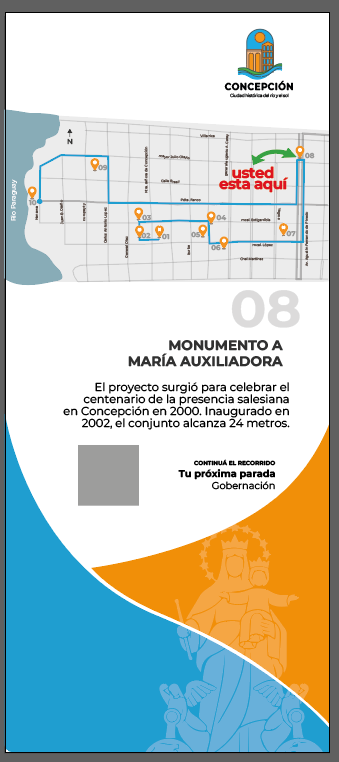

# proceso

**Exploración de la gráfica del tótem existente**

En esta etapa trabajé sobre la gráfica del tótem existente para explorar la ubicación de la información y la aplicación de los recursos de la marca ciudad. Probé distintas composiciones con fotografías, fondos de color y el símbolo de la marca como marca de agua.

Encontrar estos soportes existentes permitió trabajar con dimensiones definidas y preparar pruebas gráficas sin tener que fabricar una estructura propia para esa instancia.



<figure><figcaption></figcaption></figure>




<figure><figcaption></figcaption></figure>



También incorporé textos de los hitos para evaluar cuánto espacio ocupaban y cómo se relacionaban con los demás elementos. Durante la revisión cambié el fondo naranja y los textos blancos buscando mejorar el contraste. Luego exploré el uso de pictogramas para identificar cada lugar en reemplazo de las fotografías.

<figure><figcaption></figcaption></figure>

<figure><figcaption></figcaption></figure>

Aunque estas primeras composiciones no se mantuvieron, me ayudaron a definir qué elementos necesitaban mayor presencia y cómo organizar la información.

***

**Construcción del mapa y definición del recorrido**

Comencé señalando algunos lugares emblemáticos sobre un mapa de la ciudad. A partir de esa base, tracé las calles, incorporé sus nombres y numeré las paradas. Al relacionar los puntos, revisé la numeración para proponer una secuencia de visita.

<figure><figcaption></figcaption></figure>

En una segunda versión utilicé calles en gris y el celeste de la marca ciudad para destacar el recorrido. También ajusté el encuadre del mapa al área donde se concentraban los hitos, buscando que la información fuera más fácil de leer.

<figure><figcaption></figcaption></figure>

Quedó pendiente seguir ajustando el diseño del mapa y comprobar su lectura en los distintos soportes.

***

**Exploración del tótem con ventana arqueada**

Exploré distintas formas de incorporar un encuadre que invitara a observar y fotografiar el paisaje. Realicé bocetos, reuní referencias y utilicé imágenes generadas con IA para visualizar las alternativas en contexto.

<figure><figcaption></figcaption></figure>

La primera idea consistió en agregar una ventana arqueada al tótem existente. Durante el proceso opté por desarrollar un soporte específico con esa función, pensado para lugares con vistas de interés, y conservar la alternativa de actualizar la gráfica de los tótems ya instalados.

<figure><figcaption></figcaption></figure> <figure><figcaption></figcaption></figure>

***

**Ajustes gráficos y prueba en el lugar**

En una versión posterior ajusté el color de fondo, incorporé el pictograma del hito y apliqué los límites de extensión definidos para los textos.

Para realizar una prueba a escala real, imprimí la gráfica en dos hojas A1 y la coloqué sobre el tótem existente. Esta instancia me permitió probar la lectura del código QR y observar la legibilidad de la información en el lugar.



<figure><figcaption></figcaption></figure>

fotografias de la prueba in situ tomadas por la tarde/noche



<figure><figcaption></figcaption></figure>



Como siguiente ajuste, identifiqué la necesidad de seguir trabajando en el mapa para integrarlo mejor a la composición.

***

**Exploración del sitio web**

Trabajé en un prototipo del sitio web pensado para consultar desde el celular y ampliar la información disponible en los soportes físicos. Comencé definiendo qué datos debía incluir la página de cada hito y cómo organizarlos.

Durante las revisiones incorporé más fotografías, una página de inicio y cambios en el estilo visual. Estas exploraciones me ayudaron a definir la presentación de los contenidos y su relación con el resto del sistema.

<figure><figcaption></figcaption></figure>

**Exploración del fanzine**

Exploré formatos y plegados para desarrollar una pieza impresa que acompañara el recorrido. Consideré el espacio disponible para los contenidos, la facilidad de uso y las posibilidades de producción.

<figure><figcaption></figcaption></figure>

En las primeras composiciones probé los colores de la marca ciudad e incorporé ilustraciones realizadas a partir de detalles de las casonas. Seleccioné un plegado por su practicidad y sumé información breve de las paradas para ofrecer una visión general del recorrido.

<figure><figcaption></figcaption></figure>

